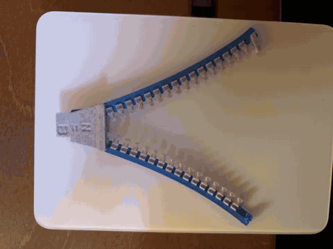
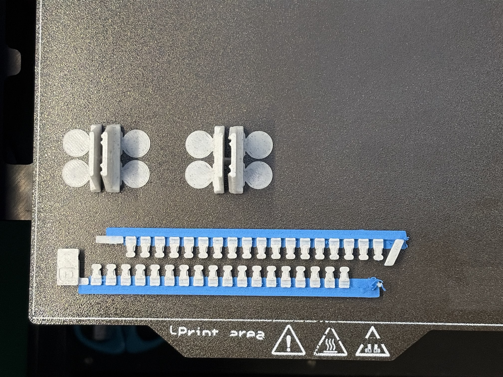

# pla-tpu-zipper

*[English](#english) · [Français](#français)*



---

## English

A working zipper printed **in one go** on a Prusa XL: rigid PLA teeth on two flexible TPU tapes, with the slider printed next to them. Peel the plate, thread the slider, and it zips.

I could not find a published example of this rigid-on-flexible mix printed on a single plate. The printed zippers I found online are all-rigid link chains (for example LoboCNC's *Print-in-Place Zipper*, 2023).

The parts were designed, checked and sliced by AI agents. I tested each version in hand and said what was wrong. It took ten days (11 to 22 November 2026).



### What you get
| Path | Content |
|---|---|
| `gcode/pla-tpu-zipper_prusa-xl-5t_pla-t1_tpu-t3.gcode` | Ready-to-print plate for a **Prusa XL 5-toolhead**, 0.4 nozzle: PLA in tool 1, TPU in tool 3. 56 min, 6.5 g PLA, 1.6 g TPU. Contains the chain and two sliders: **N** (the reference) and **V** (a tighter variant, not retained). |
| `prusaslicer/` | The PrusaSlicer profile used for that plate. |
| `zipper.py` | Generates the parts (STL) from scratch. |
| `stl/` | The parts, in print position and assembled. |
| `images/` | Parts, assembly gesture, printed plate. |

### Materials
- PLA (tested with Prusament PLA), tool 1.
- TPU (tested with ColorFabb VarioShore TPU), tool 3.
- Textured sheet, bed 60 °C. Keep the sheet clean: the teeth are small.

### Assembly
1. Peel the plate. The slider prints standing, with small adhesion ears: snap them off.
2. Push the pin (end of one tape) through the mouth of the slider.
3. Enter the top of the other tape through the narrow end of the slider.
4. Push the pin fully into the base socket.
5. Pull the slider up to close, down to open.

### What works, what doesn't
**Works**
- Teeth that interlock like a dovetail, printed already engaged with the tape.
- A **1.6 mm** TPU tape: the closed chain stays straight. With 0.8 mm it curved like a banana.
- A base where both tapes are held the same way, with a short pin: the two tapes meet level at the bottom.
- Slider **N**: low side rails that hold the tape firmly.

**Known limit**
- A slight hard point at the very end of opening, near the base: the first tooth on the pin side has to swing out right next to the rigid pin.

**Didn't work (and why it matters)**
- Thin tape (0.8 mm): the chain curls.
- Unequal anchoring of the two tapes and a pin that was too long: tapes offset at the base.
- A base socket printed as a bridge: sagging strands jam the pin.
- A one-piece base with a 0.20 mm gap: empty in the model, **filled in the G-code** by the slicer, so the rail came out welded. Lesson: check clearances in the G-code, not only in the model.
- Raising the slider's side rails to make room for the thicker tape (slider T): the tape escapes. Going back to the older, lower rails fixed it.
- Other sliders: one with a strong angle along its whole length (jerky), one too tight, one that jammed at the end.

### Regenerate the parts
```
python -m venv .venv && .venv/bin/pip install -r requirements.txt
.venv/bin/python zipper.py
```

### License
- 3D models, G-code, images: [CC BY-SA 4.0](https://creativecommons.org/licenses/by-sa/4.0/) (see `LICENSE-MODELS.md`).
- Code: MIT (see `LICENSE`).

---

## Français

Une fermeture éclair qui fonctionne, imprimée **en une seule fois** sur une Prusa XL : des dents rigides en PLA sur deux rubans souples en TPU, et le curseur imprimé juste à côté. On décolle le plateau, on enfile le curseur, et ça ferme.

Je n'ai pas trouvé d'exemple publié de ce mélange rigide sur souple imprimé d'un seul plateau. Les fermetures imprimées trouvées en ligne sont des chaînes de maillons tout en rigide (par exemple *Print-in-Place Zipper* de LoboCNC, 2023).

Les pièces ont été conçues, contrôlées et tranchées par des agents IA. J'ai testé chaque version en main et dit ce qui n'allait pas. Dix jours, du 11 au 22 novembre 2026.


### Contenu
| Chemin | Contenu |
|---|---|
| `gcode/pla-tpu-zipper_prusa-xl-5t_pla-t1_tpu-t3.gcode` | Plateau prêt à imprimer pour **Prusa XL 5 têtes**, buse 0,4 : PLA en tête 1, TPU en tête 3. 56 min, 6,5 g de PLA, 1,6 g de TPU. Contient la chaîne et deux curseurs : **N** (la référence) et **V** (variante plus serrée, non retenue). |
| `prusaslicer/` | Le profil PrusaSlicer de ce plateau. |
| `zipper.py` | Génère les pièces (STL). |
| `stl/` | Les pièces, en position d'impression et assemblées. |
| `images/` | Pièces, geste de montage, plateau imprimé. |

### Matières
- PLA (essayé avec Prusament PLA), tête 1.
- TPU (essayé avec ColorFabb VarioShore TPU), tête 3.
- Plaque texturée, lit à 60 °C. Plaque propre : les dents sont petites.

### Montage
1. Décoller le plateau. Le curseur est imprimé debout avec de petites oreilles d'adhérence : les casser.
2. Enfiler la broche (bout d'un ruban) par la bouche du curseur.
3. Entrer le haut de l'autre ruban par le côté étroit du curseur.
4. Pousser la broche au fond de l'embase.
5. Monter le curseur pour fermer, le descendre pour ouvrir.

### Ce qui marche, ce qui ne marche pas
**Marche**
- Des dents qui s'emboîtent en queue d'aronde, imprimées déjà prises dans le ruban.
- Un ruban TPU de **1,6 mm** : la chaîne fermée reste droite. À 0,8 mm, elle se cintrait en banane.
- Une base où les deux rubans sont tenus pareil, avec une broche courte : les rubans arrivent au même niveau.
- Le curseur **N** : des rebords bas qui tiennent bien le ruban.

**Limite connue**
- Un léger point dur tout en fin d'ouverture, près de la base : la première dent côté broche doit s'écarter juste à côté de la broche rigide.

**N'a pas marché (et pourquoi c'est utile)**
- Ruban fin (0,8 mm) : la chaîne se cintre.
- Ancrage inégal des deux rubans et broche trop longue : rubans décalés à la base.
- Embase imprimée en pont : des fils affaissés coincent la broche.
- Base d'un seul tenant avec un jeu de 0,20 mm : vide sur le modèle, **rempli dans le G-code** par le trancheur, rail soudé. Leçon : vérifier les jeux dans le G-code, pas seulement sur le modèle.
- Rebords du curseur remontés pour laisser passer le ruban épais (curseur T) : le ruban s'échappe. Revenir aux rebords bas d'origine a réglé le problème.
- Autres curseurs : un avec un angle fort sur toute sa longueur (à-coups), un trop serré, un qui bloquait en bout de course.

### Régénérer les pièces
```
python -m venv .venv && .venv/bin/pip install -r requirements.txt
.venv/bin/python zipper.py
```

### Licence
- Modèles 3D, G-code, images : [CC BY-SA 4.0](https://creativecommons.org/licenses/by-sa/4.0/deed.fr) (voir `LICENSE-MODELS.md`).
- Code : MIT (voir `LICENSE`).
